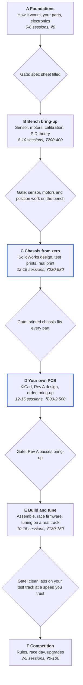

# The Line Follower Book: From Zero to Competition

*A step-by-step book for a beginner who will design the chassis and the PCB from scratch. Kit: N20 motors, RLS-08 sensor array, Arduino Nano, TB6612FNG, 2 single LiPo cells. Built for 20 to 30 minute sessions around GATE and exams.*

## Start here

You will build a line follower from zero: your own chassis (SolidWorks, 3D printed), your own PCB (KiCad), your own code, then tune it on a real track. There is no throwaway prototype in between, so every step in this book is a step toward the final robot.

### The route

1. **Part A, Foundations:** how the robot works, your parts, the electronics you need.
2. **Part B, Bench bring-up:** prove the sensor, motors, calibration and control ideas using only the Nano and a breadboard.
3. **Part C, Chassis from zero:** design it in SolidWorks, test-print, then print the real one.
4. **Part D, Your own PCB:** learn KiCad, design Rev A, order it, bring it up.
5. **Part E, Build and tune:** assemble, write the race firmware, tune on a real track.
6. **Part F, Competition:** rules, race day, upgrades.

### The honest risks, and what protects you

Going straight to a custom chassis and PCB is a good way to learn, but it is riskier than building a rough prototype first. These are the risks and the protections built into this book.

| Risk | Why it happens | Protection in this book |
| --- | --- | --- |
| First PCB has a mistake | Almost every first board does | Rev A uses plug-in modules (Nano, TB6612, buck), has test points and spare pads, and Part B proves the circuit on a breadboard first |
| Chassis does not fit the parts | Real parts differ from datasheets by a millimetre or two | Measure everything in Part A, print small test pieces first (Part C), print the real chassis last |
| Control code is untested until the robot exists | No moving robot yet | Part B tests every piece on the bench, and a laptop simulation builds your feel for PID before you touch a real robot |
| Cost grows | A PCB order adds to the budget | Appendix C lists spend by stage so you can stop at any point |
| Time runs out | GATE and exams come first | Exam mode below: reading and measuring only |

## The rules of this book

**Exam mode versus build mode**

| Mode | When | What you do | What you do not do |
| --- | --- | --- | --- |
| Exam mode | Until end-sem is over | Measure your parts (Part A), read one chapter a week | No buying, no CAD, no soldering |
| Build mode | After exams | Follow Parts B to F in order | Skip ahead before a chapter's check passes |

**Session size:** 20 to 30 minutes. Stop when time is up, even in the middle of a chapter. Every chapter ends with a **Done when** check so you know where to restart.

**One change at a time, and write it down.** Keep a log (the template is in Appendix F). Robots improve when you know exactly which change helped. They stay stuck when you change three things and cannot tell which one mattered.

**Labels used in this book**

- **Must know / Should know / Nice to know** tell you what to prioritise.
- *Verified* means seen in a datasheet or listing (still check your own board).
- *Rule of thumb* means common practice, not proven on your robot.
- *Starting value* means try it, then adjust.
- *Untested* means I have not been able to run it on your hardware.

**How much work this is:** roughly 60 to 90 sessions of 20 to 30 minutes (rule of thumb), which is about 3 to 5 months at 4 sessions a week.

### Reading map

| Part | After it you can | Sessions | Approx. spend (₹) |
| --- | --- | --- | --- |
| A Foundations | Explain every part of the robot and fill your spec sheet | 5-6 | 0 |
| B Bench bring-up | Read the sensor, drive the motors, get a stable line position, understand PID | 8-10 | 200-400 |
| C Chassis | Have a printed chassis that fits every part | 12-15 | 230-580 |
| D PCB | Have a working Rev A board | 12-15 | 800-2,500 (order, shipping and duties) |
| E Build and tune | Run laps and tune them | 10-15 | 130-150 (tape, paper, foam tape) |
| F Competition | Be ready for race day | 3-5 | 0-100 |

Spend figures are rough estimates for Mumbai and online ordering. Check them when you order.

## The route at a glance

**Six parts, each ending in a gate. The chassis and PCB are yours.**



```
+-------------------------------------------------------+
| A Foundations                                         |  5-6 sessions, ₹0
| How it works, your parts, electronics                 |
+-------------------------------------------------------+
                           |
                           v
              [Gate: spec sheet filled]
                           |
                           v
+-------------------------------------------------------+
| B Bench bring-up                                      |  8-10 sessions, ₹200-400
| Sensor, motors, calibration, PID theory               |
+-------------------------------------------------------+
                           |
                           v
   [Gate: sensor, motors and position work on the bench]
                           |
                           v
+-------------------------------------------------------+
| C Chassis from zero                                   |  12-15 sessions, ₹230-580
| SolidWorks design, test prints, real print            |
+-------------------------------------------------------+
                           |
                           v
          [Gate: printed chassis fits every part]
                           |
                           v
+-------------------------------------------------------+
| D Your own PCB                                        |  12-15 sessions, ₹800-2,500
| KiCad, Rev A design, order, bring-up                  |
+-------------------------------------------------------+
                           |
                           v
               [Gate: Rev A passes bring-up]
                           |
                           v
+-------------------------------------------------------+
| E Build and tune                                      |  10-15 sessions, ₹130-150
| Assemble, race firmware, tuning on a real track       |
+-------------------------------------------------------+
                           |
                           v
   [Gate: clean laps on your test track at a speed you trust]
                           |
                           v
+-------------------------------------------------------+
| F Competition                                         |  3-5 sessions, ₹0-100
| Rules, race day, upgrades                             |
+-------------------------------------------------------+
```

*roadmap · 6 parts, 5 gates*

Each gate is the **Done when** check at the end of that part. Do not start the next part until it passes. The two highlighted parts, C and D, are the ones you design from zero.

---

## Part A: Foundations

In exam mode you can do all of Part A in short sessions. It needs a ruler, a multimeter and your parts, nothing else.

### Chapter 1: How a line follower works

**The mental model.** Imagine driving at night with a torch pointing at the road ahead. You see where the lane edge is, decide how far you drifted, and steer a little. A line follower does exactly this, about a thousand times every second:

**SENSE** (where is the line?) then **DECIDE** (how far off am I, and which way?) then **ACT** (run one wheel faster than the other).

| Step | Job | Your part |
| --- | --- | --- |
| Sense | Measure where the line is | RLS-08 (8 sensors) |
| Decide | Turn that into a steering correction | Arduino Nano running your code |
| Act | Drive the two wheels at different speeds | TB6612 plus 2 N20 motors |
| Power | Keep the voltage steady | 2 LiPo cells plus a 5V buck converter |
| Body | Hold everything rigid and light | Your chassis and your PCB |

**Why loop speed matters (worked example).** A robot moving at 1 m/s travels 1 mm every millisecond. If your loop runs at 1,000 times a second, you correct once per millimetre. If it runs at 100 times a second, you correct once per 10 mm, and the robot can drift a long way between corrections. Faster loops give smoother, faster robots.

**Sensor geometry.** Your 8 sensors sit in a row with a gap between them called the **pitch** (call it $p$). The robot does not just ask which sensor sees the line. It takes a weighted average of all 8 readings (Part B), which gives a position far finer than one sensor width. Two things to check on your board:

- **Pitch versus line width.** If the gap between sensors is bigger than the line is wide, the line can slip between two sensors and the robot goes blind. Measure $p$ and compare it with your competition's line width.
- **Sensor height.** The RLS-08 works best about 3 mm above the floor (the listing says the recommended maximum is about 6 mm). Your chassis must hold that height reliably.

**What actually wins competitions.** In most beginner and college events, the order is: finish every run without leaving the line first, then be fast (rule of thumb).

| Factor | Why it matters | Where you handle it |
| --- | --- | --- |
| Reliability | One lost line can end a run | Parts B, D, E |
| Calibration | Lighting changes at every venue | Chapter 8 |
| Grip (tyres) | Slipping wheels make every tuning value wrong | Chapters 10 and 18 |
| Weight and balance | Light, low robots accelerate and turn better | Part C |
| PID tuning | Smooth steering at speed | Chapters 9 and 18 |
| Speed profile | Fast on straights, slow in turns | Chapter 18 |
| Knowing the rules | Line width, intersections and gaps change the code | Part F |

**The physics of fast corners (worked example).** A robot can only take a corner as fast as its tyres hold. The limit is roughly $v = \sqrt{\text{grip} \times g \times \text{radius}}$. With a grip coefficient of 0.8 (an example value, not measured) and a corner radius of 0.20 m:
$$v = \sqrt{0.8 \times 9.81 \times 0.20} = \sqrt{1.57} \approx 1.25\text{ m/s}$$
Two lessons:
1. **Grip matters more than weight for the corner limit.** The robot's mass cancels out of this formula.
2. **Light weight still helps,** because the same motor force speeds up and brakes a light robot faster.

### Chapter 2: Your parts

| Part | Job | Key facts | What to verify yourself |
| --- | --- | --- | --- |
| Arduino Nano | The brain | ATmega328P at 16 MHz, 5V logic, 10-bit analog readings (0 to 1023), 8 analog inputs (A6 and A7 are analog-only), PWM on D3, D5, D6, D9, D10, D11. One analogRead takes about 0.1 ms at default settings (rule of thumb) | Clone bootloader type (Part B) |
| TB6612FNG | Motor driver (two H-bridges) | As I recall the datasheet: motor supply roughly 4.5 to 13.5 V, about 1.2 A continuous and 3.2 A peak per channel, logic 2.7 to 5.5 V, STBY pin enables it | Your breakout's own page, and its pin order |
| N20 motors | The wheels' drive | Small geared DC motors, body about 12 × 10 mm, 3 mm D-shaft is typical. Voltage and RPM vary a lot | Label voltage and RPM, body size, shaft size |
| RLS-08 | The eyes | 8 TCRT5000 infrared pairs, analog and digital outputs per sensor, best at about 3 mm above the floor, 3 mm mounting holes. One seller lists the board as 126 × 26 mm (verified from listings, not from your board) | Real size, hole spacing, pin names, pitch |
| LiPo cell (×2) | Energy | 3.7 V nominal, 4.2 V full. Two in series give about 7.4 V nominal, 8.4 V full | Each cell's size, weight, capacity |
| Buck module | Steps the battery down to 5V | You set the output with a multimeter | Size, input range, current rating |

**Your spec sheet.** Fill this in during exam mode. Every later chapter uses it.

| Item | How to measure | Tool | Your value |
| --- | --- | --- | --- |
| N20 label voltage and RPM | Read the motor label | Eyes | |
| N20 body length × width × height | Measure | Caliper or ruler | |
| N20 shaft diameter and wheel diameter | Measure | Caliper or ruler | |
| RLS-08 width and height | Measure | Ruler | |
| RLS-08 mounting hole spacing and hole diameter | Measure | Caliper or ruler | |
| RLS-08 sensor pitch (centre to centre) | Measure | Ruler | |
| RLS-08 pin names and order | Photo of the back | Phone | |
| Each LiPo: voltage, length × width × thickness, weight | Measure | Multimeter, ruler, scale | |
| Nano: length × width, hole positions | Measure | Ruler | |
| TB6612 breakout: length × width, header spacing | Measure | Caliper or ruler | |
| Buck module: length × width × height | Measure | Ruler | |
| Total weight of all parts | Weigh them | Kitchen or jewellery scale | |

A digital Vernier caliper (about ₹250 to 400) is the single most useful tool for Parts C and D. A ruler is fine for now, but you will want the caliper before you start CAD.

### Chapter 3: The electronics you need

You can build the whole robot with these seven ideas.

**1. Voltage, current, ground (the water picture).** Voltage is water pressure, current is how much water flows, ground is the drain everything returns to. All parts must share one ground, or signals have no common reference and nothing behaves. **Must know.**

**2. Ohm's law.** Current = voltage / resistance ($I = V / R$). Example: an LED with about 2 V across it on a 5V pin through a 330 ohm resistor draws $(5 - 2) / 330 \approx 9\text{ mA}$. **Should know.**

**3. Voltage divider.** Two resistors turn a high voltage into a lower one: $V_{out} = V_{in} \times R_2 / (R_1 + R_2)$. Example for the Bluetooth module (which wants about 3.3 V on its input): $5 \times 2.2 / (1 + 2.2) = 3.44\text{ V}$. **Should know.**

**4. PWM.** The Nano cannot output "half voltage", so it switches the motor fully on and off very fast. The share of time spent on is the duty cycle. At 70% duty on 7.4 V, the motor feels an average of about 5.2 V. In code, `analogWrite(pin, 180)` is $180/255 \approx 70\%$. **Must know.**

**5. Decoupling capacitors.** Motors draw sudden bursts of current that dip the supply voltage and reset the Nano. A capacitor next to the driver acts as a tiny local water tank. You will use 100µF and 0.1µF across the motor supply. **Must know.**

**6. LiPo cells and series packs.** Two 3.7 V cells in series add to about 7.4 V. Rules for your two single cells:
1. Charge each cell separately on your charger.
2. Before joining, measure both. They should be within about 0.05 V.
3. Use two identical cells (same capacity and brand).
4. After every run, measure each cell. Recharge if either is below about 3.6 V at rest.
5. A series pair has no individual cutoff. If the robot suddenly slows down, stop and measure.
6. Never solder directly to a cell, and never leave charging cells unattended.

**Must know.**

**7. Power budget and the buck module.** Know how much current your robot draws so you can choose a buck rated for it. Measure with the multimeter in current mode, in series with the battery lead. Check the motors' stall current too (hold a wheel still for a second). Choose a buck with comfortable headroom above the total. Always set the buck's output to exactly 5.0 V with the multimeter before connecting the Nano. **Must know.**

**Why a buck and not the Nano's own regulator?** The Nano's onboard regulator turns the extra voltage into heat, and the sensors, Nano and driver logic all share that one 5V supply. A buck converter steps down efficiently and stays cool (rule of thumb).

### Done when (Part A)

- Your spec sheet is filled in.
- You can explain, in your own words, sense, decide and act, and why a faster loop helps.
- You can explain why a buck is used and why each LiPo is measured separately.

---

## Part B: Bench bring-up

This is build mode. You need only the Nano, the sensor, the TB6612, the motors, a breadboard and your battery. There is no robot body yet, which is the point: you can prove each part works before you design anything around it.

**Buy for this part (about ₹200 to 400):** breadboard, jumper wires, buck module, slide switch, 2 tactile buttons, series-harness connectors and capacitors.

### Chapter 4: Tools and setup

1. Install the Arduino IDE.
2. Plug in the Nano. Choose **Tools > Board > Arduino Nano** and **Processor > ATmega328P**.
3. Clone Nanos usually need the **CH340 driver** and **Processor > ATmega328P (Old Bootloader)**. If upload fails, try that first.
4. Upload the Blink example. The LED should blink.
5. Open the Serial Monitor at **115200 baud** and print a number each second.

**Done when:** Blink works and numbers appear in the Serial Monitor.

### Chapter 5: Read the sensor

**Mental model.** Each sensor is a flashlight plus an eye. The flashlight (infrared LED) shines on the floor. The eye (phototransistor) measures how much light bounced back. A white floor reflects a lot. A black line reflects little. The Nano turns that into a number from 0 to 1023.

**Wiring (power the Nano from USB):** S1 to S8 (left to right) go to A0 to A7. Sensor VCC to 5V, GND to GND.

```cpp
const uint8_t NUM = 8;
const uint8_t sensorPins[NUM] = {A0, A1, A2, A3, A4, A5, A6, A7};

void setup() { Serial.begin(115200); }

void loop() {
  unsigned long t0 = micros();
  uint16_t raw[NUM];
  for (uint8_t i = 0; i < NUM; i++) raw[i] = analogRead(sensorPins[i]);
  unsigned long readTime = micros() - t0;       // time for all 8 reads
  for (uint8_t i = 0; i < NUM; i++) { Serial.print(raw[i]); Serial.print('\t'); }
  Serial.print(F("| ")); Serial.println(readTime);
  delay(100);
}
```

**Do, see, understand why:**

1. Lay a strip of black tape (typical 19 mm electrical tape, or your competition's width) on white paper.
2. Hold the sensor **3 to 5 mm** above the paper. Stack 3 or 4 coins as spacers.
3. Slide it across the tape and watch the numbers.
4. **Finger test for pin order:** cover one sensor at a time with a finger. The column that changes should match that sensor's place from the left. If not, reorder the array.
5. Write down: does the raw number go **up** or **down** over the black line? What are the floor and line values per sensor? What is the read time? (About 1 ms for all 8 is expected.)

**Done when:** all 8 columns respond in the right order, with a clear gap between floor and line values.

### Chapter 6: Drive the motors

**Mental model.** The TB6612 is two switches that you control with 5V signals while the battery supplies the real motor power. For each motor, two direction pins choose forward, reverse or brake, and a PWM pin sets the speed. **STBY** is the master enable: if it is LOW, nothing moves.

**Wiring (wheels in the air, Nano on USB, shared GND):**

| TB6612 | Nano |
| --- | --- |
| PWMA, AIN1, AIN2 (left motor) | D5, D7, D8 |
| PWMB, BIN1, BIN2 (right motor) | D6, D4, D9 |
| STBY | D3 (set HIGH in code) |
| VM (motor supply) | One LiPo cell for the first test (safe for any N20) |
| VCC (logic) | Nano 5V |
| GND | Shared ground |

Put a 100µF and a 0.1µF capacitor across VM and GND, close to the driver.

```cpp
const uint8_t PWMA = 5, AIN1 = 7, AIN2 = 8, PWMB = 6, BIN1 = 4, BIN2 = 9, STBY = 3;
const int MAX_PWM = 180;        // cap: about 70%. Raise only if your motors are rated for the full pack voltage.

void setMotor(uint8_t pwmPin, uint8_t in1, uint8_t in2, int speed) {
  speed = constrain(speed, -MAX_PWM, MAX_PWM);
  if (speed > 0)      { digitalWrite(in1, HIGH); digitalWrite(in2, LOW);  analogWrite(pwmPin,  speed); }
  else if (speed < 0) { digitalWrite(in1, LOW);  digitalWrite(in2, HIGH); analogWrite(pwmPin, -speed); }
  else                { digitalWrite(in1, HIGH); digitalWrite(in2, HIGH); analogWrite(pwmPin, 0); }  // brake
}
void drive(int left, int right) { setMotor(PWMA, AIN1, AIN2, left); setMotor(PWMB, BIN1, BIN2, right); }

void setup() {
  pinMode(STBY, OUTPUT); digitalWrite(STBY, HIGH);   // STBY must be HIGH
  // also set the other six pins as OUTPUT
}
```

**Do, see, understand why:**

1. **Direction test.** Run `drive(100, 100)`, then `drive(-100, -100)`. If one wheel spins the wrong way, flip its sign in code (or add an invert flag). This is cleaner than swapping wires.
2. **Dead-zone test.** Ramp one motor from 0 to 120 in steps of 5, a few hundred ms each. Write down the PWM value where the wheel starts turning. Below this value the motor hums but does not move. Your minimum usable speed must sit above it.
3. **Cap your PWM.** If your motors are 6V and your pack is 8.4V, cap near 180 out of 255 (about 70%).

**Done when:** both wheels go forward, reverse and spin in place, and you know both dead-zone values.

### Chapter 7: Run from the battery

1. With only the buck connected (Nano disconnected), set its output to **5.0 V** using the multimeter.
2. Build the series pack: measure each cell first (within about 0.05 V of each other).
3. Wire battery, then slide switch, then buck input and TB6612 VM.
4. Wire buck output to Nano 5V pin, TB6612 VCC and sensor VCC. All grounds join.
5. Repeat the motor test from the battery. **Switch the robot off before plugging in USB.**

**Done when:** everything works with no USB cable, and the Nano does not reset when the motors start.

### Chapter 8: Calibration and line position

**Mental model.** Every sensor sees the world a little differently, and lighting changes at every venue. Calibration teaches each sensor what "floor" and "line" look like right now. After that, every reading is converted to a 0 to 1000 scale where 1000 means line. Then one weighted average tells the robot where the line is.

```cpp
const bool RAW_DROPS_ON_LINE = false;   // set from Chapter 5: does raw go DOWN over the line?
uint16_t minV[NUM], maxV[NUM];
int lastPos = 3500;

void calibrate(unsigned long ms) {            // sweep the sensor across the line while this runs
  for (uint8_t i = 0; i < NUM; i++) { minV[i] = 1023; maxV[i] = 0; }
  unsigned long start = millis();
  while (millis() - start < ms) {
    for (uint8_t i = 0; i < NUM; i++) {
      uint16_t v = analogRead(sensorPins[i]);
      if (v < minV[i]) minV[i] = v;
      if (v > maxV[i]) maxV[i] = v;
    }
  }
}

int readPosition() {                          // returns 0..7000, centre 3500
  long weighted = 0, sum = 0;
  for (uint8_t i = 0; i < NUM; i++) {
    long range = (long)maxV[i] - minV[i];
    long n = range > 0 ? ((long)analogRead(sensorPins[i]) - minV[i]) * 1000L / range : 0;
    n = constrain(n, 0, 1000);
    if (RAW_DROPS_ON_LINE) n = 1000 - n;
    if (n > 100) { weighted += n * i * 1000L; sum += n; }   // ignore weak signals
  }
  if (sum < 200) return (lastPos < 3500) ? 0 : 7000;       // line lost: go to the side we last saw it
  lastPos = weighted / sum;
  return lastPos;
}
```

**Worked examples (the weighted average).**

- The line sits centred between S4 and S5, each reading 800. Position = $(800 \times 3000 + 800 \times 4000) / 1600 = \mathbf{3500}$, dead centre.
- S4 reads 300 and S5 reads 1000. Position = $(300 \times 3000 + 1000 \times 4000) / 1300 \approx \mathbf{3769}$, so the line is slightly right of centre.

**Line lost.** If no sensor sees the line, return 0 or 7000 depending on which side it was last seen. The robot then turns hard in that direction to find it again.

**Do:** press a button to call `calibrate(4000)`, sweep the sensor across the line, then print the normalised values and the position. Check that moving the line left and right moves the position smoothly between 0 and 7000. Any sensor whose min and max are less than about 100 apart did not see both floor and line, so repeat.

**Done when:** the position moves smoothly from 0 toward 7000 as you slide the line, and lifting the sensor gives 0 or 7000, not random noise.

### Chapter 9: Control theory, made simple

The robot now knows its position. Next it must decide how hard to steer. The position error is:

`error = position - 3500` (positive means the line is to the right)

| Term | Mental model | What it does |
| --- | --- | --- |
| P (proportional) | "Steer harder the further off I am" | The main steering force |
| D (derivative) | "I am closing in on the line fast, ease off" | Damps overshoot and wobble |
| I (integral) | "I have been slightly off for a long time, push more" | Fixes slow drift. Often tiny or zero |

```cpp
int error = position - 3500;
integral += error;                     // clamp this so it cannot grow forever
int derivative = error - lastError;
lastError = error;
float correction = Kp * error + Ki * integral + Kd * derivative;
int left  = baseSpeed + correction;    // line on the right: left wheel faster, robot turns right
int right = baseSpeed - correction;
drive(left, right);
```

**Worked example (numbers).** Kp = 0.1, Kd = 3, base speed 100. The error is +1500 now and was +1520 on the last loop. P term = $0.1 \times 1500 = 150$. D term = $3 \times (1500 - 1520) = -60$. Correction = 90. Left wheel = 190 (capped to your PWM limit), right wheel = 10. The D term took 60 away because the robot is already closing in on the line. Without D, the robot would keep turning hard and shoot past the line.

**Try it on your laptop first (no robot needed).** This is a toy simulation I ran in my sandbox. It uses made-up numbers (7 cm sensor arm, 15 mm sensor pitch, motors that take about 50 ms to respond), so it shows trends, not your robot's real values.

```python
import math
def run(Kp, Kd, base=100, L=0.07, track=0.09, pitch=0.015, k=0.005, tau=0.05):
    y, th, vl, vr, last = 0.03, 0.0, k*base, k*base, 0.0   # start 3 cm left of the line
    dt, over, bad = 0.001, 0.0, 0.0
    for n in range(4000):                                   # 4 seconds
        ys = y + L*math.sin(th)                             # where the sensor is
        err = max(-3500, min(3500, ys/pitch*1000))          # + means the line is to the right
        corr = Kp*err + Kd*(err-last); last = err
        left  = max(0, min(180, base+corr))
        right = max(0, min(180, base-corr))
        vl += (k*left  - vl)*dt/tau                         # motors respond slowly
        vr += (k*right - vr)*dt/tau
        th += (vr-vl)/track*dt
        y  += (vl+vr)/2*math.sin(th)*dt
        over = max(over, -ys*1000)                          # overshoot to the other side, in mm
        if abs(ys) > 0.002: bad = n*dt                      # last time we were more than 2 mm off
    return round(over, 1), round(bad, 2)

for Kp, Kd in [(0.01,0), (0.05,0), (0.1,0), (0.4,0), (0.1,0.6), (0.4,2.0), (0.1,3.0)]:
    print(Kp, Kd, run(Kp, Kd))
```

Results from my run (overshoot to the other side of the line, and time to settle within 2 mm):

| Kp | Kd | Overshoot (mm) | Settled after (s) |
| --- | --- | --- | --- |
| 0.01 | 0 | 17.3 | 1.52 |
| 0.05 | 0 | 16.8 | 0.51 |
| 0.1 | 0 | 15.4 | 0.38 |
| 0.4 | 0 | 14.0 | 0.37 |
| 0.1 | 0.6 | 12.0 | 0.27 |
| 0.4 | 2.0 | 9.9 | 0.20 |
| 0.1 | 3.0 | 3.3 | 0.20 |

**What the simulation teaches:**

1. A bigger Kp makes the robot settle faster, but with P alone the overshoot barely shrinks.
2. Adding Kd cuts overshoot sharply (15.4 mm down to 3.3 mm here). This is the whole reason PID has a D term.
3. Your real robot differs: tyre slip, sensor noise and loop timing all change the numbers. Use the simulation to understand the shape, never to set your final values.

**Done when:** you can explain what P and D each do in your own words, and you have run the simulation and changed Kp and Kd yourself.

---

## Part C: Chassis from zero

You need your Part A spec sheet filled in, and a caliper helps a lot. The goal of this part is a printed chassis that holds every part rigidly, keeps the sensor at the right height, and weighs as little as practical. You will test-fit small prints before the real one, so a mistake costs a few rupees, not a whole chassis.

**Buy for this part:** Vernier caliper (₹250 to 400), M2 and M3 screws, nuts and standoffs (₹40 to 80), printing (₹150 to 400).

### Chapter 10: Chassis physics and design rules

**Mental model.** The chassis is a rigid table that keeps four things in exactly the right place: the wheels, the sensor, the battery and the board. Everything else is detail.

**The layout.** There is no single perfect layout. Start with Layout A, which matches your reference photo: drive wheels near the rear, the sensor bar on an arm in front, and a smooth skid under the front of the board.

```
FRONT
  [==== RLS-08 bar ====]    3 to 5 mm above the floor
        |        |          arm with slots (length and height adjust)
   +--------------------+
   |   PCB    battery   |   [skid] under the front of the board
   +--------------------+
 (wheel)=====axle=====(wheel)
REAR
```

| Layout | Good | Watch out for |
| --- | --- | --- |
| A: wheels at the rear, skid at the front | Simple sensor arm, matches your reference | Skid friction if too much weight sits on it |
| B: wheels near the middle, skid at the tail | Can turn more tightly | Sensor arm and weight balance are harder to get right |

**Key dimensions (starting values, measure and adjust).**

| Dimension | What it does | Starting value |
| --- | --- | --- |
| Track width (wheel centre to wheel centre) | Narrow turns faster, wide is more stable | About 80 to 100 mm (rule of thumb) |
| Sensor arm length (axle to sensor row) | Longer sees turns earlier, but acts like a lever and can add wobble | About 60 to 80 mm, with slots to adjust by about 20 mm |
| Sensor height | The RLS-08 works best at about 3 mm (verified from listings) | 3 to 5 mm, adjustable |
| Ground clearance elsewhere | Nothing else should touch the floor | At least 2 to 3 mm |
| Centre of gravity | Just ahead of the axle, low down | About 80% of the weight on the wheels (rule of thumb) |

**Weight budget.** Weigh every part (your spec sheet has the column) and fill this in before you design anything. Light robots accelerate and turn faster, but only up to the grip limit you saw in Chapter 1.

| Item | Your weight (g) | Notes |
| --- | --- | --- |
| RLS-08 sensor board | | One of the heaviest items because of its size |
| 2 × N20 motor with wheel | | |
| 2 × LiPo cell | | Mount low and between the wheels |
| Nano | | |
| TB6612 module | | |
| Buck module | | |
| Your PCB (Part D) | | A thinner board weighs less |
| Chassis print | | Your biggest design lever |
| Screws, standoffs, wires | | They add up |
| Tyres | | |
| **Total** | | Aim as low as practical. Under about 150 g is a reasonable first target (rule of thumb) |

**Printing choices (rule of thumb, ask your printer).**

| Setting | Suggestion | Why |
| --- | --- | --- |
| Material | PLA | Stiff, easy, cheap. PETG is tougher but a little softer |
| Plate thickness | 2 to 3 mm | Thinner flexes, thicker adds weight |
| Perimeters | 3 | Gives most of the strength |
| Infill | 20 to 30% | The reference project used 100%, which is stiffer but heavier. Test and decide |
| Layer height | 0.2 mm | Good balance of speed and detail |

**Tolerances.** Printed holes come out slightly small. Add clearance: about 2.2 to 2.4 mm for M2 screws, about 3.2 to 3.4 mm for M3 (starting values). For motors, a press-fit pocket needs trial and error, which is why Chapter 12 has test prints.

**Done when:** your weight budget is filled in, you have chosen Layout A or B, and you have a dimension table with real numbers.

### Chapter 11: SolidWorks from zero

You have the SolidWorks student license. Menu names below match recent versions, but they can differ slightly in yours.

**Mental model.** CAD has one loop: **sketch a flat shape, give it exact dimensions, turn it into a 3D feature.** Every part you design is a pile of these.

**Lesson 1: A plate.** New Part, pick the Top plane, Sketch, draw a Rectangle, use **Smart Dimension** to set 80 × 100 mm, exit the sketch, then **Extruded Boss/Base** to 2.5 mm. *See:* a flat plate. *Why:* every chassis starts as a plate.

**Lesson 2: Holes.** Sketch on the plate's top face and add circles, or use the **Hole Wizard**. Make an M3 clearance hole at 3.4 mm. *See:* a hole through the plate. *Why:* holes are where parts bolt on.

**Lesson 3: Cuts and slots.** Sketch a **Slot** and use **Extruded Cut**. *See:* an adjustable slot. *Why:* slots let you adjust sensor height and arm length without reprinting.

**Lesson 4: Patterns and mirrors.** Use **Linear Pattern** and **Mirror** to repeat holes and make the left side match the right. *Why:* a symmetric chassis drives straight.

**Lesson 5: Fillets.** Round the inside corners with **Fillet**. *Why:* sharp inside corners crack in plastic.

**Lesson 6: Global variables.** Open **Tools > Equations** and make variables such as track width, arm length and plate thickness. Use them in dimensions. *Why:* change one number and the whole design updates, so tuning the arm length later is easy.

**Lesson 7: Assembly.** Start a new Assembly, **Insert Components**, and use **Mates** (Coincident, Concentric, Distance) to position parts. *Why:* you see how everything fits before you print.

**Lesson 8: Check for clashes.** Run **Evaluate > Interference Detection**. *Why:* it finds parts that overlap before you waste a print.

**Lesson 9: Drawings (optional).** Make a drawing of a part with its dimensions. *Why:* handy for a printer who asks for dimensions.

**Lesson 10: Export.** **File > Save As** and choose STL. Set binary format, units in millimetres, and fine resolution. *Why:* STL is what printers read.

**Design these parts in this order.** Each one is a small, testable step.

1. **Reference sheet:** one page of real dimensions from your spec sheet.
2. **Motor mount** (one part, used twice).
3. **Base plate:** wheels, skid mount, board standoffs.
4. **Sensor arm and mount:** slots for length and height.
5. **Battery holder** for your actual cell sizes, with a strap slot.
6. **Assembly:** all parts together, then interference check.
7. **Export and print** (Chapter 12).

**Practice before the real design:** model a small test card with five holes and a slot. If you can do that, you can do everything in the list above.

**Done when:** you have modelled the base plate, motor mount and sensor mount, and the interference check shows no clashes.

### Chapter 12: Print plan and test fits

**Mental model.** Print cheap, small test pieces first. If the test fits, the real chassis fits.

**Test prints (low infill, fast settings, a few rupees each).**

| Test | What it tells you |
| --- | --- |
| Hole card: holes from 2.0 to 2.6 mm in 0.1 mm steps, and 3.0 to 3.6 mm | Which hole size your printer needs for M2 and M3 |
| Motor pocket card: four pockets with extra clearance of 0.0, 0.1, 0.2 and 0.3 mm | The press-fit size for your N20 |
| Sensor slot card: your RLS-08 hole spacing on a small plate | Whether the sensor mount lines up |
| Battery pocket: a short block with your cell size | Whether the cells fit and can be strapped |

**Do:** print the test cards, test each real part against them, write the winning sizes into your Equations, then update the CAD.

**Then print the real chassis.** Check: parts fit without forcing, nothing clashes, screws grip. Remove support material and sand rough edges.

**Dry-fit:** assemble the chassis with all real parts (no wiring yet). Check sensor height at 3 to 5 mm with coins as spacers, wheel clearance, and that nothing scrapes the floor.

**Done when:** the real chassis holds every part rigidly, the sensor height is adjustable, and your weight budget total matches the weight on the scale.

---

## Part D: Your own PCB

This part turns your breadboard circuit into a board that fits your chassis. You need three things first: the circuit working on the breadboard (Part B), the real dimensions of every module (Part A spec sheet), and your chassis CAD (Part C), because the board outline and mounting holes must match it.

**Be ready for Rev A to have mistakes.** Almost every first board does. This part plans for that: plug-in modules instead of bare chips, test points, and a bring-up routine that finds problems before anything can be damaged.

**Spend for this part:** the PCB order, roughly ₹800 to 2,500 including shipping and duties (rough estimate, check at order time), plus headers, connectors and small parts (about ₹150 to 300).

### Chapter 13: KiCad from zero

**Mental model.** A PCB design has two views of the same circuit. The **schematic** is the wiring diagram: which pin connects to which, with no regard to position. The **PCB layout** is the physical board: where each part sits and which copper track carries each connection. KiCad keeps them linked through **nets** (a net is a group of pins that are connected).

**The workflow, in order.**

1. **New project.** One project holds both views.
2. **Schematic editor.** Place symbols (A), draw wires (W), add net labels (L) and power symbols (P). Run the **Electrical Rules Check (ERC)** until it reports no real errors.
3. **Assign footprints.** A footprint is the physical pad pattern for a part. Choose one for every symbol.
4. **Update PCB from schematic** (F8 in recent versions). Parts appear in the PCB editor, joined by thin "ratsnest" lines showing what still needs a track.
5. **Draw the board outline** on the **Edge.Cuts** layer.
6. **Place parts, then route** tracks (X). Add a **copper zone** (a filled area) for ground and fill it (B).
7. **Design Rules Check (DRC)** until clean.
8. **Look at it in the 3D viewer,** then export **Gerber and drill files** and open them in a Gerber viewer to confirm they match.

Hotkeys can differ slightly between KiCad versions, so use the menus if a key does nothing.

**Words you will meet.**

| Word | Meaning |
| --- | --- |
| Pad | The copper spot you solder a pin to |
| Track | A copper wire on the board |
| Via | A small hole that moves a track to the other side |
| Clearance | Minimum gap between copper of different nets |
| Silkscreen | Printed labels on the board |
| Courtyard | Keep-out outline around a part |
| Edge.Cuts | The layer that defines the board outline |

**Practice first (2 to 3 sessions).** Design a tiny board with one LED, one resistor and one button. Get ERC and DRC clean, look at it in 3D, and export Gerbers. Do not order it. The point is to learn the whole loop on something small.

**Done when:** you have exported a clean Gerber set for the tiny practice board.

### Chapter 14: Designing Rev A

**The big decision: modules or bare chips.**

| Option | What it means | Verdict |
| --- | --- | --- |
| A: modules on headers | The board has female headers for the Nano and TB6612 breakout, plus pads for the buck module | **Do this for Rev A.** Easy to solder, easy to replace a burnt module, lowest risk |
| B: bare chips | Put the ATmega328P and the TB6612 chip directly on the board, mostly surface-mount | A later project (Chapter 21). Harder to solder and debug |

**What goes on the board.**

| Ref | Part | Notes |
| --- | --- | --- |
| J1 | Battery connector (XT30 or JST-XH 2-pin) | Mark polarity clearly on the silkscreen |
| SW1 | Slide switch | Switch the pack positive before the buck and driver VM |
| U1 | Nano on 2 × 15-pin female headers | Row spacing from your measurement of the real Nano |
| U2 | TB6612 breakout on female headers | Measure your real module: header spacing and row spacing |
| U3 | Buck module (4 pads or pins) | Set it to 5.0 V on the bench before soldering it down |
| J2 | Sensor connector | 10 pins: VCC, GND and the 8 analog outputs. Match your RLS-08 and cable |
| J3, J4 | Motor outputs | 2-pin each (header or pads) |
| SW2, SW3 | Tactile buttons | Start on D2, Calibrate on D10, each to GND |
| D1, R1 | Status LED with a 330 ohm resistor | On D12. The Nano's own LED is on D13 |
| C1, C2 | 100µF and 0.1µF | Across VM and GND, right next to U2 |
| C3 | 0.1µF | Across 5V and GND, near the Nano |
| J5, R2, R3 | HC-05 header (optional) with a 1k and 2.2k divider | Nano TX to HC-05 RX through the divider |
| JP1, JP2 | Two jumpers on the Bluetooth TX and RX lines | Lets you disconnect Bluetooth during uploads |
| TP1 to TP4 | Test points: 5V, GND, battery +, VM | Makes debugging easy |
| H1 to H4 | Mounting holes | Positions taken from your chassis CAD |

Use the pin map in Appendix A for every Nano connection.

**Layout rules (rule of thumb, adjust for your board).**

| Rule | Why |
| --- | --- |
| Ground pour on the bottom layer | Gives every part a short, low-resistance ground |
| Motor and battery tracks 0.5 to 1.0 mm wide | About 0.3 mm is the rough minimum for 1 A on standard outer copper at a modest temperature rise, so use more for margin |
| Signal tracks 0.25 mm | Plenty for logic |
| Keep motor power tracks away from the sensor analog lines | Motor noise shows up as wobbling sensor readings |
| Put C1 and C2 right next to the TB6612 VM pin | Decoupling only works when it is close |
| One ground point at the battery connector (a star ground) | Stops motor current from flowing through sensor grounds |
| Put connectors at the board edge | Easy to plug and unplug |
| Label every pin and polarity on the silkscreen | You will thank yourself during debugging |
| Board outline and mounting holes from your chassis CAD | Export a DXF from SolidWorks and import it into KiCad as a graphic on Edge.Cuts (File > Import > Graphics) |
| Board thickness 1.0 mm instead of 1.6 mm (check the fab's options) | A thinner board is lighter |

**Review before you order (never skip this).**

1. ERC and DRC both clean.
2. **Print the layout at 1:1 on paper** and place the real modules on it. If the headers line up with the real parts, the footprints are right. This single test catches most footprint mistakes.
3. Check header orientation. A mirrored footprint is a classic error: pin 1 of each module must be where your schematic says.
4. Check battery polarity on the connector, silkscreen and net.
5. Trace each power net with the 3D view and the net highlight tool.
6. Ask a friend to review it. A second pair of eyes finds mistakes you can no longer see.

**Nice to know:** reverse polarity protection (a series Schottky diode costs voltage and heat; a P-channel MOSFET is better) is worth adding on Rev B if you can be disciplined about connector polarity until then.

**Done when:** the review checklist is complete and the board outline fits your chassis CAD with matching mounting holes.

### Chapter 15: Ordering and bring-up

**Order.**

1. In KiCad, plot **Gerber files** (all copper, mask, silkscreen and Edge.Cuts) and **drill files**. Zip them.
2. Upload them to a PCB fabricator and look at the previewed layers. Compare them with your 3D view.
3. Typical settings: 2 layers, FR-4, 1.0 to 1.6 mm thick, lead-free HASL, quantity 5 (a common minimum). Delivery to India often takes 1 to 3 weeks (rule of thumb), and shipping and duties can cost more than the boards, so check the total. A local fabricator may be quicker for a small run.

**Solder in this order (lowest parts first).** Resistors, then small capacitors, then the buttons, then the headers, then the switch, then the large capacitor, then connectors. Use flux, and a temperature around 320 to 350 deg C for leaded solder (rule of thumb). Check every joint with a magnifier.

**Bring-up routine (do these steps in order and stop at the first surprise).**

| Step | Do | Expect |
| --- | --- | --- |
| 1 | Look at the board under bright light and a magnifier | No solder bridges, no missed pads |
| 2 | With **nothing inserted** and no battery, measure resistance between battery plus and ground | Not a short (a very low number or a beep means a bridge) |
| 3 | Set the buck to 5.0 V on the bench, then solder it down | Output reads 5.0 V |
| 4 | Connect the battery (no modules inserted) and switch on | Battery voltage at the test point, 5.0 V at the 5V test point |
| 5 | Switch off, insert the **Nano only**, switch on | The Nano powers up with its LED lit |
| 6 | Upload Blink | It blinks |
| 7 | Insert the TB6612, then the sensor | No smoke, no heat, no resets |
| 8 | Repeat the tests from Chapters 5 to 8 on the new board | All pass |

**If Rev A has errors.** Cut a wrong track with a sharp knife, and add a fix with thin enamelled wire. Write every error in a table so Rev B fixes it properly.

| Error found | Workaround used | Fix in Rev B |
| --- | --- | --- |
| | | |

**Done when:** Rev A powers up cleanly and every test from Chapters 5 to 8 passes on it.

---

## Part E: Build, firmware and tuning

You now have a printed chassis, a working Rev A board, and every test from Part B passing. This part puts them together and turns the robot into something that follows a line quickly.

**Spend for this part:** about ₹100 for a test track (black tape, white paper or a plain banner), plus silicone tyres (₹40 to 100).

### Chapter 16: Assembly day

**Mental model.** Assemble in the order that lets you test after every step. If something fails, you know which step caused it.

| Step | Do | Check |
| --- | --- | --- |
| 1 | Fit motors into their mounts and fit wheels and tyres | Wheels spin freely, no rubbing |
| 2 | Mount the base plate on the motors, add the skid | Robot sits level, nothing touches the floor except wheels and skid |
| 3 | Mount the PCB on standoffs (no modules yet) | Mounting holes line up, no stress on the board |
| 4 | Attach the battery with its strap and foam | Pack is secure and low |
| 5 | Fit the sensor arm and sensor, set the height to 3 to 5 mm with coin spacers | Sensor is square to the floor and parallel to the axle |
| 6 | Plug in the Nano and TB6612, connect motors and sensor | Cables clear of the wheels |
| 7 | **Wheels lifted off the ground:** switch on and run a motor test | Both wheels turn the right way |
| 8 | Weigh the finished robot | Compare with your weight budget |

**Cable care.** Keep motor and battery wires away from the sensor cable. Use short wires and a small dab of hot glue or a zip tie to stop them flapping.

**Done when:** the robot is fully assembled, steering direction is correct with the wheels off the ground, and the total weight is within a few grams of your budget.

### Chapter 17: Race firmware

**Mental model.** Your robot is a small state machine with four states. It only ever does one thing at a time, and moving between states needs a button press.

| State | What it does | Leaves when |
| --- | --- | --- |
| IDLE | Waits | You press Calibrate |
| CALIBRATING | LED on, sweep the sensor over the line for 4 seconds | Time is up |
| READY | Waits, motors off | You press Start |
| RUNNING | The control loop below | You press Start again, or the line is lost too long |

**Rules for race code.**

1. **Fixed loop timing.** Run the control step at a steady rate (1,000 times a second is a reasonable target). Steady timing makes the D term meaningful.
2. **Never print in the race loop.** At 115200 baud one byte takes about 87 µs, so a 40-character line can stall the loop for several milliseconds once the serial buffer fills.
3. **Stop safely.** If the line is lost for too long, stop the motors instead of driving away.
4. **Clamp everything.** Clamp the integral, the speeds and the PWM.

A starting skeleton. It uses `readPosition()`, `calibrate()` and `drive()` from Part B. Add a global `bool lineLost;` and set `lineLost = (sum < 200);` inside `readPosition()`.

```cpp
const uint8_t BTN_START = 2, BTN_CAL = 10, LED = 13;
enum State { IDLE, CALIBRATING, READY, RUNNING };
State state = IDLE;

float Kp = 0.05, Ki = 0.0, Kd = 0.5;      // starting values only, tune on the real robot
int baseSpeed = 100;                       // must be well above the dead-zone you measured
int maxSpeed = 140, minSpeed = 60;         // minSpeed above the dead-zone
int slowDiv = 40;                          // bigger = slows less in turns
const unsigned long LOOP_US = 1000;        // 1 kHz
const unsigned long LOST_TIMEOUT_MS = 500;

int lastError = 0; long integral = 0;
unsigned long lastLoop = 0, lostSince = 0;

bool pressed(uint8_t pin) {
  if (digitalRead(pin) == LOW) {
    delay(30);
    if (digitalRead(pin) == LOW) { while (digitalRead(pin) == LOW) {} return true; }
  }
  return false;
}

void runStep() {
  unsigned long now = micros();
  if (now - lastLoop < LOOP_US) return;     // keep a steady rate
  lastLoop = now;

  int pos = readPosition();
  if (lineLost) {
    if (lostSince == 0) lostSince = millis();
    if (millis() - lostSince > LOST_TIMEOUT_MS) { drive(0, 0); state = READY; return; }
  } else lostSince = 0;

  int error = pos - 3500;
  integral = constrain(integral + error, -20000, 20000);
  int derivative = error - lastError; lastError = error;
  float corr = Kp * error + Ki * integral + Kd * derivative;

  int speed = constrain(maxSpeed - abs(error) / slowDiv, minSpeed, maxSpeed);   // slower in turns
  drive(speed + corr, speed - corr);
}

void loop() {
  switch (state) {
    case IDLE:        if (pressed(BTN_CAL)) state = CALIBRATING; break;
    case CALIBRATING: digitalWrite(LED, HIGH); calibrate(4000); digitalWrite(LED, LOW); state = READY; break;
    case READY:       if (pressed(BTN_START)) { integral = 0; lastError = 0; lostSince = 0; delay(1000); state = RUNNING; } break;
    case RUNNING:     runStep(); if (pressed(BTN_START)) { drive(0, 0); state = READY; } break;
  }
}
```

**This code is untested.** I could not compile it or run it on your hardware. Compile it, read each line, and test it step by step with the wheels off the ground before the first floor run. If it does not compile, send me the error.

**Done when:** the code compiles, the state machine moves through its four states with the wheels off the ground, and the wheels respond correctly when you tilt the sensor bar left and right.

### Chapter 18: Tuning and speed

**Build a test track.** Use matte white paper or a plain banner (glossy surfaces reflect and confuse the sensors) and 19 mm black electrical tape, or your competition's line width. Build in stages:

| Track | What it teaches |
| --- | --- |
| A: oval with long straights and gentle curves | Basic PID tuning |
| B: S-curves | Smooth steering and damping |
| C: sharp 90 degree corners | Speed profile and line-lost recovery |
| D: intersections and gaps | Whatever your event rules require (Part F) |

**The tuning procedure (one change at a time, write it in your log).**

1. **Direction check, wheels off the ground.** Tilt the sensor so the line is on the right. The left wheel should speed up and the right should slow down. If not, swap the sign on the correction.
2. **Slow straight line.** Set a low base speed that is still well above the dead-zone. The robot should hold a straight line.
3. **Raise Kp** until it follows the line with a slight wobble.
4. **Add Kd** until the wobble calms down. The reference project's example sketch used Kp 0.07 and Kd 0.6 at a base speed of 100, so a Kd roughly 10 times Kp is a reasonable *starting value*.
5. **Test curves** on Track A and B.
6. **Raise speed** in small steps (see below).
7. **Add the speed profile** by lowering `slowDiv` until it slows enough in turns.
8. **Add Ki last,** tiny or zero. Many fast robots barely use it (rule of thumb).

**Symptom guide.**

| Symptom | Likely fix |
| --- | --- |
| Fast left-right wobble | Kp too high, or Kd too low |
| Runs wide on turns | Kp too low |
| Jittery or shaky at high frequency | Kd too high (it amplifies sensor noise) |
| Slowly drifts on long curves | A tiny Ki |
| Leaves the line at corners | Slow the corner speed (smaller `slowDiv`, lower `minSpeed`) |
| Different behaviour on each run | Battery state, tyres or sensor height changed |

**The speed-up ladder.**

1. Raise `baseSpeed` and `maxSpeed` by 5 to 10 PWM.
2. Run 3 clean laps. If clean, keep it.
3. If it fails, drop back one step and retune Kd, then try again.
4. Log every change and every lap time.

**Grip and consistency.** Clean the tyres with tape or a lint-free cloth before each session, keep the track clean, always start from the same charged state, and check sensor height every time (coins as spacers). Most "random" changes in behaviour come from these four things.

**Your tuning log.**

| Date | Each cell (V) | Kp | Ki | Kd | Base | Max | Sensor height | Result | Lap time |
| --- | --- | --- | --- | --- | --- | --- | --- | --- | --- |
| | | | | | | | | | |

**Done when:** the robot completes your test tracks cleanly at a speed you trust, and your log shows what you tried and what each change did.

---

## Part F: Competition

A fast robot can still lose to a robot that is better prepared. This part covers reading the rules, preparing for the track elements your event uses, and running race day with a plan.

### Chapter 19: Rules and track elements

**Read the rules before you finalise anything,** ideally before Part C, because some rules change the design. Ask the organisers if anything is unclear.

| Rule to check | Why it matters |
| --- | --- |
| Line width and colour (black on white, or the reverse?) | Sensor pitch, calibration direction |
| Maximum robot size and weight | Chassis dimensions, sensor bar width |
| Battery limits (voltage, chemistry) | Whether your 2-cell series pack is allowed |
| Scoring (best time, average, finishing at all) | How aggressive to be |
| Number of attempts and practice time | Strategy on the day |
| Start method (button, touch, hand release) | How you start the robot |
| Intersections, gaps, sharp turns, obstacles, ramps | Code you need to add |
| Banned items (for example fans or suction) | What upgrades are allowed |

**Track elements and how the robot should respond.** These are common elements. Your event may use only some of them. These are ideas to implement later, not finished code.

| Element | What the sensors see | Typical response |
| --- | --- | --- |
| Gentle curves | One or two sensors on the line | Plain PID |
| Sharp 90 degree turn | Several sensors on one side see black while the other side sees white | Turn that way until the centre sensors see the line again |
| Intersection or crossing | Most or all sensors see black | Go straight for a short, fixed time, ignoring the line |
| Gap (line missing for a few centimetres) | No sensor sees the line briefly | Keep going straight at the last heading, and allow a longer lost-line timeout |
| Start and finish markers | The outer sensors (S1 or S8) see a mark while the middle sees the line | Count laps or stop the timer when required |
| Ramps or bumps | Sensor height changes | Check clearance and sensor mounting height |

When you know your event's rules, tell me and I will help write the code for the elements you actually need.

**Done when:** you have the rules in front of you and have marked which of these elements your event uses.

### Chapter 20: Race day

**Mental model.** Race day is a process, not a performance. If you follow the same routine every run, you remove most surprises.

**Before leaving home.**

| Check | Done |
| --- | --- |
| Both cells fully charged, each measured with the multimeter | [ ] |
| A spare pair of charged cells, also measured | [ ] |
| Code backed up on your laptop, and the last good settings written down | [ ] |
| Spare Nano, TB6612 and buck if your budget allows | [ ] |
| Tools: small screwdrivers, spare screws, wire, solder, tape, multimeter | [ ] |
| Coins or a feeler gauge for setting sensor height | [ ] |
| Tyre-cleaning tape or cloth | [ ] |
| Your log, the rules and the track layout if you have it | [ ] |

**At the venue.**

1. **Practise on the real track if you are allowed.** Lighting and surface differ from your home track.
2. **Recalibrate on the actual track before every run.** This is the single biggest cause of avoidable failures.
3. **Check sensor height with your coins** and clean the tyres.
4. **Start with a safe setting.** A clean finish on the board beats a fast crash.
5. **Raise speed in steps** using the same ladder as Chapter 18, but only after you have a clean time recorded.
6. **Change one thing at a time,** and write down what you changed.
7. **Do not change anything major at the last minute.** Last-minute changes are untested changes.

**After each run.** Measure each cell, write the result in your log, and decide the single next change. After the event, review your log and note what to improve.

**Done when:** you have a printed or written checklist you trust, and you have rehearsed the routine at least once at home.

### Chapter 21: Upgrades

Only upgrade when you know what is limiting you. Guessing wastes money.

| Upgrade | What it gives you | When it makes sense | Rough cost |
| --- | --- | --- | --- |
| Encoders on the motors | Real wheel speed, so speed control and track mapping | When your speed is limited by inconsistent motor behaviour | Costly for your budget |
| Custom sensor bar (a small KiCad project) | A lighter, narrower bar with a pitch of your choice | When the 126 mm bar's weight or width limits you | PCB plus parts |
| Better motors or a different gear ratio | More top speed or more torque | When the straights or the acceleration limit you | Varies |
| A 2-cell pack with a balance lead, plus a balance charger | Safer series charging and balanced cells | When you want a proper battery setup | About ₹900 to 1,600 (rule of thumb) |
| Faster ADC clock | Faster sensor reads | When loop time limits you | Free |
| Bare-chip PCB (Option B in Chapter 14) | Smaller, lighter board | After Rev A and Rev B are solid | PCB plus SMD parts |
| Downforce fan or suction | More grip | Only if the rules allow it. Many events ban it | Varies |

**Nice to know: a faster ADC clock.** The Nano's default analog reads take about 0.1 ms each. This line makes them several times faster at a small cost in accuracy (rule of thumb). Test before relying on it:

```cpp
ADCSRA = (ADCSRA & 0xF8) | 0x04;   // ADC clock prescaler 16
```

**What to learn next.** Once the robot is running well, the next big skills are encoder-based speed control, mapping the track on the first lap, and a custom sensor bar.

---

## Appendices

### Appendix A: Pin map (Arduino Nano)

| Function | Pin |
| --- | --- |
| Sensors S1 to S8 (left to right) | A0, A1, A2, A3, A4, A5, A6, A7 |
| Left motor: PWMA, AIN1, AIN2 | D5, D7, D8 |
| Right motor: PWMB, BIN1, BIN2 | D6, D4, D9 |
| Driver standby (STBY, must be HIGH) | D3 |
| Start button (to GND, INPUT\_PULLUP) | D2 |
| Calibrate button (to GND, INPUT\_PULLUP) | D10 |
| Status LED (external, with 330 ohm resistor) | D12 |
| Onboard LED | D13 |
| Bluetooth HC-05 (optional): TX to Nano RX, Nano TX to HC-05 RX through the divider | D0, D1 |
| Spare | D11 |

The sensor order (S1 to S8) is an assumption until you run the finger test in Chapter 5. Unplug or jumper out the Bluetooth lines while uploading code, because D0 and D1 are shared with USB.

### Appendix B: Power wiring

| From | To |
| --- | --- |
| Cell 1 minus | Pack GND |
| Cell 1 plus | Cell 2 minus |
| Cell 2 plus | Slide switch, then buck IN+ and TB6612 VM |
| Pack GND | Buck IN minus, TB6612 GND, every other GND |
| Buck OUT 5.0V | Nano 5V pin, TB6612 VCC, sensor VCC, HC-05 VCC |
| 100µF and 0.1µF | Across VM and GND, next to the TB6612 |

Set the buck to **5.0 V with a multimeter before** connecting the Nano. Always switch the robot **off** before plugging in USB. The LiPo rules are in Chapter 3.

### Appendix C: Shopping by stage

Prices are rough Mumbai and online estimates (rule of thumb). Check them when you order. Buy a stage only when you reach it, and stop whenever you like.

| Stage | Items | Approx. spend (₹) | Buy when |
| --- | --- | --- | --- |
| Part A | Vernier caliper (optional but very useful) | 250-400 | After exams |
| Part B | Breadboard and jumper wires, buck module, slide switch, 2 buttons, series-harness connectors and wire, capacitors (100µF, 0.1µF) | 230-440 | When you start Part B |
| Part C | M2 and M3 screws, nuts and standoffs; test prints and the chassis print; silicone tyres | 230-580 | After your CAD is checked |
| Part D | PCB order (with shipping and duties); headers, connectors, resistors, LED, buttons, capacitors; sensor cable and header | 1,000-2,900 | After the design review |
| Part E | Black tape, white paper or banner, foam tape, zip ties | 130-150 | When the robot is assembled |
| Part F | Spare TB6612 and spare Nano (optional) | 0-300 | Before the competition |
| Optional | HC-05 Bluetooth module | 250-350 | When you want wireless tuning |

**Total for the whole custom route:** roughly ₹1,800 to 4,800 without Bluetooth. The PCB order is the biggest swing. My earlier perfboard plan was cheaper (₹600 to 1,350), but it did not include your own PCB.

### Appendix D: Troubleshooting

| Symptom | Likely cause |
| --- | --- |
| Upload fails | Wrong bootloader setting, missing CH340 driver, or Bluetooth wires still connected |
| Motors never move | STBY not HIGH, no VM power, or no shared ground |
| Nano resets when the motors start | Missing capacitors, a loose ground, or a weak battery |
| One wheel spins the wrong way | Flip its sign in code |
| Robot spins in place | One motor reversed |
| Sensor position jumps around | Sensor too high or too low, a sensor with a tiny calibration range, or motor noise on the sensor lines |
| One sensor never changes | Bad wire, or you are reading the wrong output pin |
| Works at home but fails at the venue | Lighting changed, so recalibrate on the actual track |
| Behaviour changes from run to run | Battery state, tyre dirt, or sensor height |
| Board gets hot at power-up | Short circuit: switch off, then measure between power and ground |

### Appendix E: Glossary

| Word | Simple meaning |
| --- | --- |
| PWM | Switching power on and off very fast to control motor speed |
| Error | How far the line is from the centre |
| PID | A steering formula using the size, the change and the history of the error |
| Calibration | Teaching each sensor what floor and line look like right now |
| Dead-zone | Low PWM values where the wheel does not turn |
| STBY | The driver's master enable pin |
| Buck | A module that steps the battery voltage down to 5 V |
| Series pack | Two cells joined to add their voltages (about 7.4 V) |
| Pitch | The distance between neighbouring sensors |
| Net | A group of pins that are connected (KiCad) |
| Footprint | The pad pattern a part is soldered onto (KiCad) |
| Gerber | The file format a PCB factory reads |
| STL | The file format a 3D printer reads |
| Rev A, Rev B | First and second versions of your board |

### Appendix F: Session log

Copy a row for each session. Writing one line takes a minute and saves hours.

| Date | Chapter | What I did | What happened | Next |
| --- | --- | --- | --- | --- |
| | | | | |

### Appendix G: A weekly rhythm

| Mode | Suggested rhythm |
| --- | --- |
| Exam mode (until end-sem) | One 20-minute session a week: measure one part for the spec sheet, or read one chapter |
| Build mode, normal weeks | Four sessions of 20 to 30 minutes (for example three on weekdays and one longer one at the weekend), each ending with one line in the log |
| Busy weeks | Pause. Do not rush Part C or Part D, because mistakes there cost money |

### Your next step

In exam mode, fill in the spec sheet in Chapter 2 (a ruler, a multimeter and your parts are enough). When you have it, send me the numbers and I will check them against the chassis and PCB plan before you start Part B.
